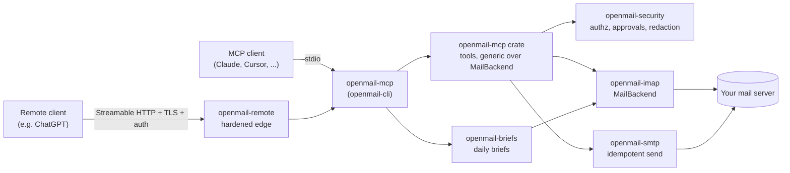

# OpenMail MCP

A local-first, security-first [Model Context Protocol](https://modelcontextprotocol.io) server for email.
It lets an AI client read, search and (when you allow it) organize and draft mail over plain IMAP/SMTP,
with your credentials and your mail staying on your machine.

> **Project status: pre-release (0.1.0).** The read/search/organize/draft/send tools, send approvals, the stdio and
> HTTPS transports, daily briefs and the CLI are implemented and tested against a real IMAP/SMTP server (GreenMail).
> It has **not** been tested against Gmail, Microsoft 365 or Dovecot, has had no independent security audit, and
> binaries are unsigned. Read [docs/RELEASE_READINESS.md](docs/RELEASE_READINESS.md) before relying on it.
> Features are tagged **[available]** (implemented and tested) or **[in development]**.

## Why

- Email is the most sensitive data an assistant can touch, and mailbox text is attacker-controlled
  (prompt injection). OpenMail treats every message body as untrusted data, never as instructions.
- Most mail MCP servers are tied to one provider API and hold broad tokens. OpenMail speaks standard IMAP/SMTP,
  so it works with Gmail, Outlook, Fastmail, iCloud, Yahoo and any generic server.
- Safe defaults: accounts are **read-only** until you grant permissions per account; deleting is a separate permission.

## How it works



More diagrams (send-approval and OAuth sequences, crate map): [docs/ARCHITECTURE_DIAGRAMS.md](docs/ARCHITECTURE_DIAGRAMS.md).
Contracts and crate rules: [docs/ARCHITECTURE.md](docs/ARCHITECTURE.md).

## Security model

| Property | Status |
|---|---|
| Config is TOML with unknown keys rejected; inline secrets are rejected, only references (`env` var or `keyring` entry) are allowed | **[available]** (`openmail-core`) |
| Accounts default to `read_only = true`; `organize`, `drafts`, `send` and `delete` are separate per-account permissions, enforced on every tool call | **[available]** |
| Stable message references that detect a changed mailbox (UIDVALIDITY mismatch becomes `StaleReference`) | **[available]** (`openmail-core`) |
| Errors never carry secrets or message bodies in `Display` output | **[available]** |
| Diagnostics scrub secrets before export | **[available]** (`openmail-observe`) |
| Human-granted single-use send approvals, sanitized mailbox text, per-account rate limits | **[available]** |
| HTTP edge: Origin check (DNS rebinding), bearer/JWT auth, body and time limits, per-IP rate limit, health probes | **[available]** |
| `serve --transport http` refuses to start without TLS cert/key and an auth token file; there is no override flag | **[available]** |
| JWT validation against a rotating JWKS and RFC 9728 protected-resource metadata; no token passthrough | **[available]** |
| Container runs as uid 10001, read-only root fs, no Docker socket | **[available]** (`Dockerfile`, `compose.yaml`) |

See [docs/THREAT_MODEL.md](docs/THREAT_MODEL.md), [docs/SECURITY_REVIEW.md](docs/SECURITY_REVIEW.md) and [SECURITY.md](SECURITY.md).

## Providers

`openmail-mcp init` ships presets (host, port, TLS mode, auth guidance) **[available]**:

| Preset | IMAP | SMTP | Auth |
|---|---|---|---|
| `gmail` | imap.gmail.com:993 | smtp.gmail.com:465 | app password (2-step verification required) |
| `outlook` | outlook.office365.com:993 | smtp.office365.com:587 STARTTLS | OAuth2 access token |
| `fastmail` | imap.fastmail.com:993 | smtp.fastmail.com:465 | app password |
| `icloud` | imap.mail.me.com:993 | smtp.mail.me.com:587 STARTTLS | app-specific password |
| `yahoo` | imap.mail.yahoo.com:993 | smtp.mail.yahoo.com:465 | app password |
| `generic` | you supply host/port | you supply host/port | password or OAuth2 |

OAuth2 helpers (authorization code + PKCE request building, token refresh, Google and Microsoft endpoint presets)
exist in `openmail-oauth` **[available]** as a library; they are **[in development]** as an end-to-end login flow
(no loopback listener, no token persistence, not wired to IMAP/SMTP). See `crates/openmail-oauth/NOTES.md`.

## Limitations

- Tested only against GreenMail; Gmail, Microsoft 365 and Dovecot are untested. Provider presets follow vendor docs.
- OAuth2 for Gmail/Microsoft is a tested library (`openmail-oauth`) but has no end-to-end login flow yet; use app passwords or a pre-obtained token.
- Not independently audited. Binaries are unsigned; no published crate.
- IMAP only for reading (no POP3, no Gmail API or Microsoft Graph).

## Install

Build from source (Rust 1.100+, edition 2024) **[available]**:

```bash
git clone https://github.com/hanzlahabib/openmail.git
cd openmail
cargo build --release -p openmail-cli --bin openmail-mcp
./target/release/openmail-mcp --version
```

Docker (`Dockerfile`, `compose.yaml`, [examples/docker](examples/docker/README.md)) runs the HTTPS transport as a non-root user.

## Quick start

```bash
openmail-mcp init        # interactive wizard: preset, account, permissions, writes config atomically with mode 0600
openmail-mcp doctor      # validates config and credential references
openmail-mcp accounts list
```

The wizard also prints a ready-to-paste MCP client snippet. Secrets are never typed into the config: put the
app password in an environment variable and reference it:

```toml
# ~/.config/openmail-mcp/config.toml  (all values below are fake)
version = 1

[[account]]
id = "personal"
display_name = "Personal"
email = "me@example.com"
auth = "password"
read_only = true

[account.imap]
host = "imap.example.com"
port = 993
tls = "implicit"

[account.credential]
kind = "env"
var = "OPENMAIL_PERSONAL_PASSWORD"
```

`init`, `doctor`, `accounts list|test` and `serve` are **[available]**.

## MCP client configuration

A client entry looks like this **[available]**:

```json
{
  "mcpServers": {
    "openmail": {
      "command": "openmail-mcp",
      "args": ["serve"],
      "env": { "OPENMAIL_PERSONAL_PASSWORD": "<app password>" }
    }
  }
}
```

`init` generates client snippets for you.

## CLI

Global flags: `--config <PATH>` (env `OPENMAIL_CONFIG`; default `$XDG_CONFIG_HOME/openmail-mcp/config.toml`), `--log <FILTER>` (env `OPENMAIL_LOG`, default `warn`; logs go to stderr because stdout is the MCP channel).

| Command | Purpose |
|---|---|
| `init [--force]` | Create a starter config |
| `doctor` | Check config, credential references and connectivity |
| `accounts list` / `accounts test [ACCOUNT]` | List accounts / test IMAP and SMTP |
| `serve [--transport stdio\|http] [--bind ADDR]` | Run the MCP server (http needs TLS + auth; default bind `127.0.0.1:8765`) |
| `approvals list\|show\|grant\|deny` | Human-side send approvals (never reachable from an MCP tool) |
| `brief now [--lookback 24h] [--account ID] [--format md\|json] [--email]` | Generate a brief now (`--email` mails it to the digest account's own address only) |
| `brief schedule list` | List scheduled briefs (schedules run under `serve` when enabled in `briefs.toml`) |

Exit codes: 0 success, 1 runtime failure, 2 usage error.

Mailbox management on a server (`accounts add|remove`, `accounts.d/`, secret files, `failure` diagnostics): [docs/deployment/ACCOUNTS.md](docs/deployment/ACCOUNTS.md).

## Multi-account

Many `[[account]]` entries (up to 500), each with its own credentials, permissions, folder map, connection cap
(default 2) and timeout (default 30 s), plus a global connection cap (default 8). Tested with 3 accounts; 50/100-mailbox
load is not verified yet ([docs/PERFORMANCE_REPORT.md](docs/PERFORMANCE_REPORT.md)).

## Remote access (Streamable HTTP)

`openmail-mcp serve --transport http` serves MCP over in-process TLS with bearer or OAuth 2.1 resource-server auth.
It requires `OPENMAIL_HTTP_TLS_CERT`, `OPENMAIL_HTTP_TLS_KEY` and `OPENMAIL_HTTP_AUTH_TOKEN_FILE` (or the JWT variables);
paths only, secrets are never accepted as flags, and there is no override. **[available]**

## ChatGPT

Setup notes and the local verification record are in `integrations/chatgpt`. Not tested against a live ChatGPT account.

## Daily briefs

Heuristic summaries of mailbox metadata (never authoritative): aggregation across accounts (a failed account is reported
as failed, never as quiet), rule-based classification, follow-up detection, processed-mail tracking, an opt-in cron scheduler
with a SQLite lease, and an optional AI overview that is metadata-only by default. MCP tools: `brief_generate`,
`brief_get_latest`, `brief_list_action_items`, `brief_get_followups`, `brief_get_status`. Optional settings live in
`briefs.toml` next to the main config; see `crates/openmail-briefs/NOTES.md`. **[available]**

## Privacy

- Nothing leaves your machine unless you start the HTTP transport or configure an AI summarization endpoint.
- No telemetry. Tracing goes to stderr and is filtered by `--log`; diagnostic exports are scrubbed of secrets.
- AI summarization is off unless an explicit policy is configured; the default payload is metadata only, and message text is framed as untrusted data.
- Credentials are resolved at the moment of use from an environment variable or the OS keyring, never stored in config.

## Troubleshooting

| Symptom | Cause / fix |
|---|---|
| `refusing --transport http without TLS` / `without authentication` | Set the three `OPENMAIL_HTTP_*` variables. This check has no override. |
| Config rejected with an unknown-key error | Unknown keys are rejected on purpose; check spelling against `init` output. |
| Gmail / iCloud / Yahoo authentication fails | Use an app password, not your account password. |
| Outlook basic auth rejected | Most Microsoft 365 tenants require OAuth2. |
| Garbage on stdout breaks the client | Never log to stdout; use `--log` (stderr only). |

## Contributing

Open an issue before large changes. Run `cargo fmt`, `cargo clippy -p <crate> --all-targets -- -D warnings` and
`cargo test -p <crate>`. Rules: no `unwrap`/`expect` outside tests, no `println!` in libraries, fake credentials only,
public contracts in `openmail-core` change only with architecture-owner approval ([docs/ARCHITECTURE.md](docs/ARCHITECTURE.md)).

## License

MIT, see [LICENSE](LICENSE).
