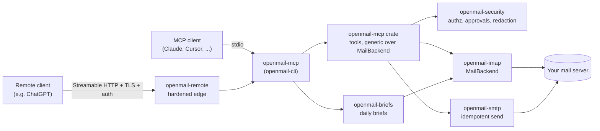

# OpenMail MCP

A local-first, security-first [Model Context Protocol](https://modelcontextprotocol.io) server for email.
It lets an AI client read, search and (when you allow it) organize and draft mail over plain IMAP/SMTP,
with your credentials and your mail staying on your machine.

> **Project status: pre-release (0.1.0, wave 2 in progress).** The tree builds as a workspace, but the
> IMAP, SMTP, MCP-protocol and security crates are still stubs, so **`openmail-mcp serve` does not serve
> mail yet**. Every feature below is tagged against the real code:
>
> - **[available]**: implemented in the tree and covered by tests.
> - **[in development]**: contract or partial code exists, end-to-end behavior does not. Do not rely on it.
>
> The ledger of who built what is in [docs/AGENT_EXECUTION.md](docs/AGENT_EXECUTION.md).

## Why

- Email is the most sensitive data an assistant can touch, and mailbox text is attacker-controlled
  (prompt injection). OpenMail treats every message body as untrusted data, never as instructions.
- Most mail MCP servers are tied to one provider API and hold broad tokens. OpenMail speaks standard IMAP/SMTP,
  so it works with Gmail, Outlook, Fastmail, iCloud, Yahoo and any generic server.
- Safe defaults: accounts are **read-only** until you grant permissions per account; deleting is a separate permission.

## How it works



More diagrams (send-approval and OAuth sequences, crate map): [docs/ARCHITECTURE_DIAGRAMS.md](docs/ARCHITECTURE_DIAGRAMS.md).
Contracts and crate rules: [docs/ARCHITECTURE.md](docs/ARCHITECTURE.md).

## Security model

| Property | Status |
|---|---|
| Config is TOML with unknown keys rejected; inline secrets are rejected, only references (`env` var or `keyring` entry) are allowed | **[available]** (`openmail-core`) |
| Accounts default to `read_only = true`; `organize`, `drafts`, `send` and `delete` are separate per-account permissions | **[available]** as config; **[in development]** as enforced tool authorization |
| Stable message references that detect a changed mailbox (UIDVALIDITY mismatch becomes `StaleReference`) | **[available]** (`openmail-core`) |
| Errors never carry secrets or message bodies in `Display` output | **[available]** |
| Diagnostics scrub secrets before export | **[available]** (`openmail-observe`) |
| Send approval flow, redaction of mailbox text for the model, rate limits | **[in development]** (`openmail-security` is a stub) |
| HTTP edge: Origin check (DNS rebinding), bearer auth, body and time limits, per-IP rate limit, health probes; refuses non-loopback bind without auth | **[available]** as a library (`openmail-remote`); **[in development]** as a running server (not linked into the CLI) |
| `serve --transport http` refuses to start without TLS cert/key and an auth token file; there is no override flag | **[available]** |
| JWT validation against a rotating JWKS and RFC 9728 protected-resource metadata; no token passthrough | **[available]** as a library (`openmail-remote`) |
| Container runs as uid 10001, read-only root fs, no Docker socket | **[available]** (`Dockerfile`, `compose.yaml`) |

Threat model document (`docs/THREAT_MODEL.md`) and `SECURITY.md` are **[in development]**. The dependency-license audit is not done yet ([docs/DECISIONS.md](docs/DECISIONS.md) D5).

## Providers

`openmail-mcp init` ships presets (host, port, TLS mode, auth guidance) **[available]**:

| Preset | IMAP | SMTP | Auth |
|---|---|---|---|
| `gmail` | imap.gmail.com:993 | smtp.gmail.com:465 | app password (2-step verification required) |
| `outlook` | outlook.office365.com:993 | smtp.office365.com:587 STARTTLS | OAuth2 access token |
| `fastmail` | imap.fastmail.com:993 | smtp.fastmail.com:465 | app password |
| `icloud` | imap.mail.me.com:993 | smtp.mail.me.com:587 STARTTLS | app-specific password |
| `yahoo` | imap.mail.yahoo.com:993 | smtp.mail.yahoo.com:465 | app password |
| `generic` | you supply host/port | you supply host/port | password or OAuth2 |

OAuth2 helpers (authorization code + PKCE request building, token refresh, Google and Microsoft endpoint presets)
exist in `openmail-oauth` **[available]** as a library; they are **[in development]** as an end-to-end login flow
(no loopback listener, no token persistence, not wired to IMAP/SMTP). See `crates/openmail-oauth/NOTES.md`.

## Limitations

- No mail is read or sent yet: the IMAP, SMTP and MCP-protocol crates are stubs, so there are no MCP tools to call today.
- `accounts test`, `brief now`, `brief schedule list`, keyring checks in `doctor`, and both `serve` transports report "not wired yet" instead of pretending to work.
- No prebuilt binaries, packages or published crate. The repository URL in `Cargo.toml` is a placeholder.
- IMAP only for reading (no POP3, no provider-specific APIs such as Gmail API or Microsoft Graph).

## Install

Build from source (Rust 1.100+, edition 2024) **[available]**:

```bash
git clone <repository-url> openmail-mcp   # public URL not set yet
cd openmail-mcp
cargo build --release -p openmail-cli --bin openmail-mcp
./target/release/openmail-mcp --version
```

Docker **[available]** as a build recipe (`Dockerfile`, `compose.yaml`, [examples/docker](examples/docker/README.md)); the container
image runs the HTTP transport, which is **[in development]** until `openmail-remote` is linked into the CLI.

## Quick start

```bash
openmail-mcp init        # interactive wizard: preset, account, permissions, writes config atomically with mode 0600
openmail-mcp doctor      # validates config and credential references
openmail-mcp accounts list
```

The wizard also prints a ready-to-paste MCP client snippet. Secrets are never typed into the config: put the
app password in an environment variable and reference it:

```toml
# ~/.config/openmail-mcp/config.toml  (all values below are fake)
version = 1

[[account]]
id = "personal"
display_name = "Personal"
email = "me@example.com"
auth = "password"
read_only = true

[account.imap]
host = "imap.example.com"
port = 993
tls = "implicit"

[account.credential]
kind = "env"
var = "OPENMAIL_PERSONAL_PASSWORD"
```

`init`, `doctor` (config checks) and `accounts list` are **[available]**. Starting the server is **[in development]**.

## MCP client configuration

Once stdio serving lands, a client entry looks like this **[in development]**:

```json
{
  "mcpServers": {
    "openmail": {
      "command": "openmail-mcp",
      "args": ["serve"],
      "env": { "OPENMAIL_PERSONAL_PASSWORD": "<app password>" }
    }
  }
}
```

`init` generates client snippets for you **[available]**; they only become usable when `serve` is.

## CLI

Global flags: `--config <PATH>` (env `OPENMAIL_CONFIG`; default `$XDG_CONFIG_HOME/openmail-mcp/config.toml`), `--log <FILTER>` (env `OPENMAIL_LOG`, default `warn`; logs go to stderr because stdout is the MCP channel).

| Command | Purpose | Status |
|---|---|---|
| `init [--force]` | Create a starter config | **[available]** |
| `doctor` | Check config and credential references | **[available]**; keyring and connectivity probes **[in development]** |
| `accounts list` | List configured accounts | **[available]** |
| `accounts test [ACCOUNT]` | Test IMAP/SMTP connectivity | **[in development]** |
| `serve [--transport stdio\|http] [--bind ADDR]` | Run the MCP server (default bind `127.0.0.1:8765`) | validation and http refusal **[available]**; serving **[in development]** |
| `brief now` | Generate a brief | **[in development]** |
| `brief schedule list` | List scheduled briefs | **[in development]** |

Exit codes: 0 success, 1 runtime failure, 2 usage error.

## Multi-account

Config supports many `[[account]]` entries (up to 500), each with its own credentials, permissions, folder map,
connection cap (default 2) and timeout (default 30 s), plus a global connection cap (default 8) **[available]** as validated config.
Bounded-concurrency aggregation across mailboxes exists in `openmail-briefs` **[available]**; the IMAP pool that
would use these limits is **[in development]**.

## Remote access (Streamable HTTP)

`openmail-remote` provides the hardened HTTP edge, bearer and OAuth 2.1 resource-server auth **[available]** as a library.
`openmail-mcp serve --transport http` requires `OPENMAIL_HTTP_TLS_CERT`, `OPENMAIL_HTTP_TLS_KEY` and
`OPENMAIL_HTTP_AUTH_TOKEN_FILE` (paths only; secrets are never accepted as flags) **[available]**, then exits with
"not wired yet" **[in development]**.

## ChatGPT

Connecting ChatGPT requires the remote transport and OAuth. `integrations/chatgpt` exists but contains no
working connector yet: **[in development]**.

## Daily briefs

`openmail-briefs` implements, with tests **[available]** as a library: multi-mailbox aggregation, rule-based message
classification with user rules, follow-up detection (awaiting reply / needs reply), SQLite store, delivery renderers with
an idempotent audit, an opt-in cron scheduler with leases, missed-run recovery and backoff, and an optional AI
summarization boundary that is metadata-only by default and refuses unsafe endpoints. CLI wiring is **[in development]**.

## Privacy

- Nothing leaves your machine unless you start the HTTP transport or configure an AI summarization endpoint.
- No telemetry. Tracing goes to stderr and is filtered by `--log`; diagnostic exports are scrubbed of secrets.
- AI summarization is off unless an explicit policy is configured; the default payload is metadata only, and message text is framed as untrusted data.
- Credentials are resolved at the moment of use from an environment variable or the OS keyring, never stored in config.

## Troubleshooting

| Symptom | Cause / fix |
|---|---|
| `error: ... is not wired yet` | The feature is **[in development]**; see the tables above. |
| `refusing --transport http without TLS` / `without authentication` | Set the three `OPENMAIL_HTTP_*` variables. This check has no override. |
| Config rejected with an unknown-key error | Unknown keys are rejected on purpose; check spelling against `init` output. |
| Gmail / iCloud / Yahoo authentication fails | Use an app password, not your account password. |
| Outlook basic auth rejected | Most Microsoft 365 tenants require OAuth2. |
| Garbage on stdout breaks the client | Never log to stdout; use `--log` (stderr only). |

## Contributing

Open an issue before large changes. Run `cargo fmt`, `cargo clippy -p <crate> --all-targets -- -D warnings` and
`cargo test -p <crate>`. Rules: no `unwrap`/`expect` outside tests, no `println!` in libraries, fake credentials only,
public contracts in `openmail-core` change only with architecture-owner approval ([docs/ARCHITECTURE.md](docs/ARCHITECTURE.md)).

## License

MIT, see [LICENSE](LICENSE).
