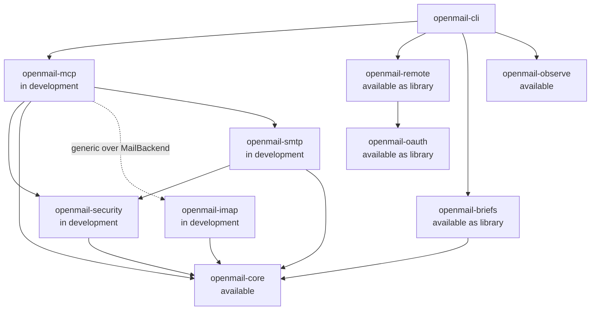
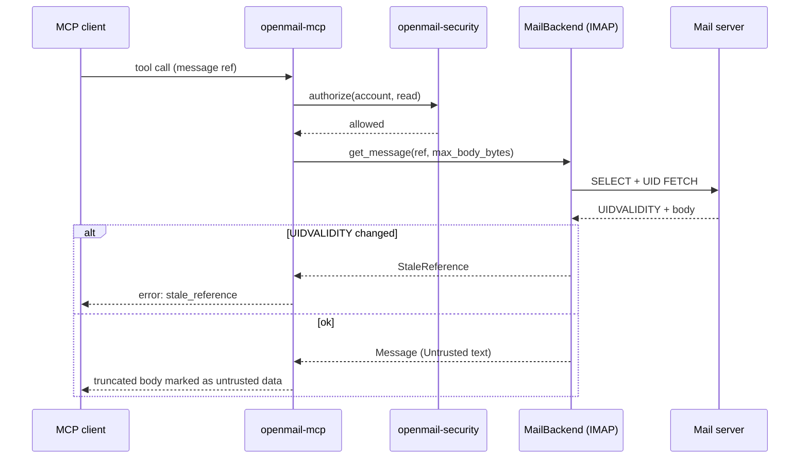
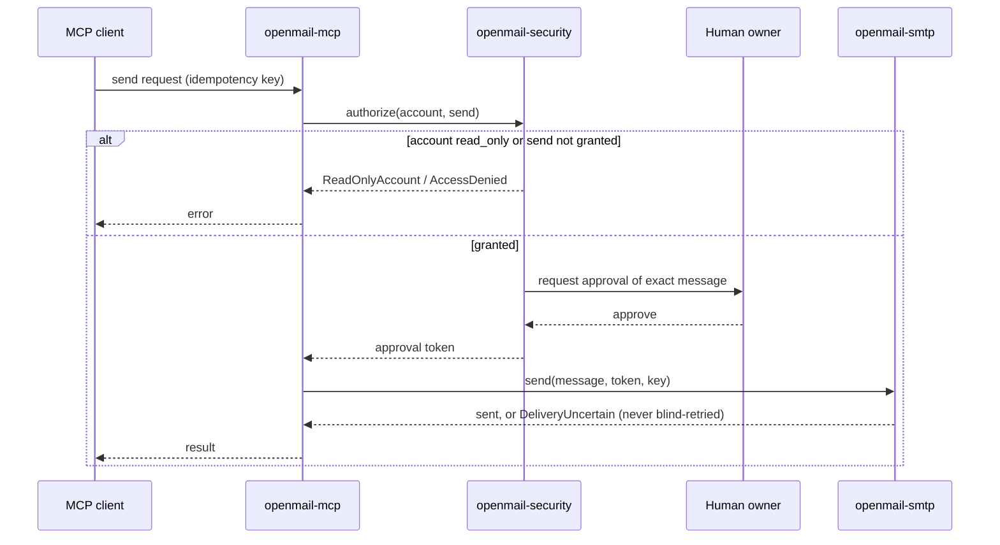
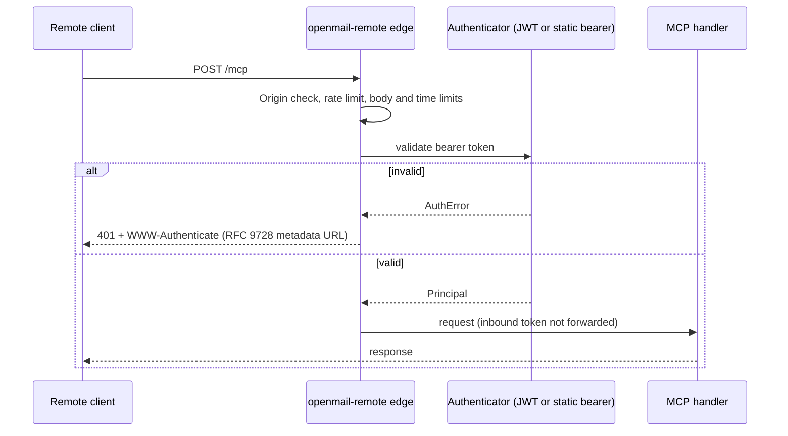

# Architecture diagrams

Companion to [ARCHITECTURE.md](ARCHITECTURE.md). Diagrams show the **target design**; see the README for which parts
are implemented today. Marked **[available]** / **[in development]** as of this commit.

## Crate map

Rule: the MCP crate never touches IMAP types, only the `MailBackend` / `MailOrganizer` traits.

## Reading a message (target flow) [in development]

## Sending with approval (target flow) [in development]

## Remote request through the HTTP edge [available as library, not linked into CLI]

